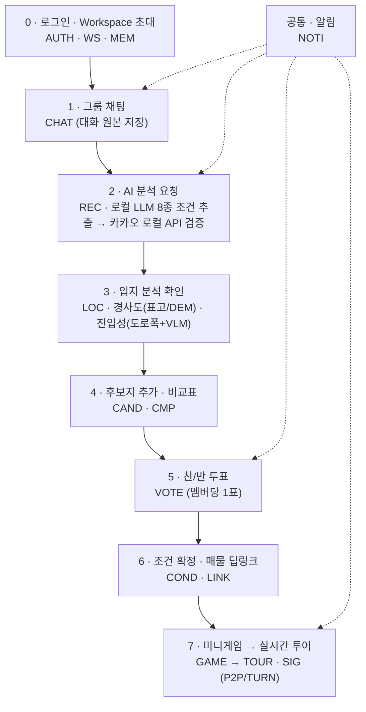

# ZIPFIT — Backend (`zipfit`)

> **같이 집 찾고, 비교하고, 투표하고, 실시간으로 둘러보기.** 친구·룸메이트 그룹이 하나의 Workspace에서 대화 → AI 분석 → 입지 검증(경사도·진입성) → 비교 → 투표 → 매물 검색 → 실시간 룸투어까지 이어서 처리하는 서비스의 백엔드 저장소.

2026 계명대학교 컴퓨터공학전공 **캡스톤 디자인(1)** 프로젝트 · 팀 **목데이터**


> 📄 이 README는 Notion [ZIPFIT PRD](https://app.notion.com/p/3ffb90513fa081478a30fd5e21aa6743) v0.8 · [ZIPFIT 기능명세서](https://app.notion.com/p/3ffb90513fa08135b7d9e3e1e0cbe012) v0.9 기준으로 작성되었습니다. Notion 게스트 권한만 있어 Claude 연동이 안 되는 팀원을 위해 **[`PRD.md`](./PRD.md) / [`기능명세서.md`](./기능명세서.md)** 로 전문을 이 저장소에도 미러링해 두었습니다. 원본은 Notion이며, 더 최신일 수 있습니다.

---

## 목차

1. [Overview](#overview)
2. [Core Features](#core-features)
3. [서비스 흐름](#서비스-흐름)
4. [Tech Stack](#tech-stack)
5. [Getting Started](#getting-started)
6. [환경 변수](#환경-변수)
7. [Folder Structure](#folder-structure)
8. [API 개요 (Draft)](#api-개요-draft)
9. [데이터베이스](#데이터베이스)
10. [외부 API 사용 정책 및 법적 고려사항](#외부-api-사용-정책-및-법적-고려사항)
11. [Collaboration Rules](#collaboration-rules)
12. [Team — 목데이터](#team--목데이터)
13. [Schedule](#schedule)
14. [관련 문서](#관련-문서)

---

## Overview

집을 혼자 구할 때는 조건만 맞으면 되지만, **여럿이 함께 구할 때는 합의 과정 자체가 일**이 된다.

| # | 문제 | 설명 |
|---|---|---|
| P1 | 의견 조율의 어려움 | 채팅방에서 나온 의견이 정리되지 않고 흩어져, 어디가 최적의 입지인지 합의하기 어렵다. |
| P2 | 파편화된 입지 정보 | 경사도·일조량·소음 같은 입지 정보가 여러 사이트에 흩어져 있어 후보지끼리 객관적으로 비교하기 어렵다. |
| P3 | 다 같이 방문하기 어려움 | 그룹 전원이 매물을 직접 방문하기엔 시간·비용 부담이 크고 일정을 맞추기 어렵다. |
| P4 | 협업 결과와 매물 검색의 단절 | 논의·비교·투표를 마쳐도 매물을 찾으려면 조건을 다시 입력해 여러 사이트를 따로 검색해야 한다. |

**ZIPFIT은 이 문제를 하나의 Workspace 안으로 가져온다.** 그룹 대화를 로컬 LLM이 분석해 조건을 추출하고, 추천 위치를 공유 지도에 표시하고, 후보지까지 가는 길의 경사도·차량 진입 가능 여부를 공공데이터 + 촬영 이미지 VLM으로 검증한다. 멤버들은 비교표와 찬/반 투표로 합의한 뒤 확정 조건으로 매물 검색 링크를 받고, 방문자 1명이 송출하는 WebRTC 실시간 투어로 함께 집을 둘러본다.

### 목표 (PRD 3장)

- **G1. 협업 의사결정 지원** — 그룹 대화에서 집 조건을 추출하고 추천 위치를 공유 지도에 표시
- **G2. 데이터 기반 입지 검증** — 경사도·차량 진입 가능 여부를 근거·신뢰도와 함께 제공
- **G3. 합의 과정 가시화** — 비교표 + 찬/반 투표로 의견이 갈리는 지점을 표시
- **G4. 검색 연결** — 확정 지역·조건으로 매물 검색 사이트 딥링크 자동 생성
- **G5. 비대면 실사** — 방문자 1명의 모바일 영상을 나머지 멤버가 실시간 시청

### 비목표

매물 크롤링·저장, 상용 거리뷰(카카오·네이버·구글) 이미지 분석, 계약·결제·중개, 투어 영상 녹화, 자동(비요청) AI 분석, 전국 서비스(대구 시범 지역 한정), 관리자 기능, 배리어프리(휠체어 접근성) 분석은 **하지 않는다**. 지역 커뮤니티·SFU 대규모 투어·모델 재학습은 **캡스톤(2) 범위**다.

**1차 개발 범위(캡스톤(1) MVP)는 PRD 7장의 P0 요구사항 전체**다. 상세는 [`PRD.md`](./PRD.md), [`기능명세서.md`](./기능명세서.md) 참고.

---

## Core Features

> 기능 ID·CRUD·우선순위·예외 규칙의 전체 목록은 [`기능명세서.md`](./기능명세서.md) 3~5장 참고. 여기서는 핵심 흐름(PRD 6장, 0~7단계) 기준으로 요약한다.

| 단계 | 기능 ID | 설명 | 우선순위 |
|---|---|---|---|
| **0. 회원·Workspace** | `AUTH-01~09` | 카카오 로그인(P0) · 자체 회원가입/로그인/비밀번호 재설정(P1) · 내 정보 관리 · 토큰 재발급 | P0 (일부 P1) |
| | `WS-01~04` | Workspace 생성·조회·수정·삭제 | P0 |
| | `MEM-01~06` | 초대 링크 발급(7일 만료)·참여, 멤버 조회, 호스트 위임·내보내기·나가기 | P0 |
| **1. 채팅** | `CHAT-01~02` | 실시간 채팅 전송(WebSocket/STOMP)·대화 기록 조회. 대화 원본은 AI 분석의 입력 | P0 |
| **2. AI 위치 추천** | `REC-01~03` | 로컬 LLM이 대화에서 **8가지 조건**(지역·보증금·월세·면적·편의시설·목적지·경사 조건·차량 조건) 추출 → 카카오 로컬 API로 후보 검증 → 추천 이유 생성 → **조건 제안**(대화에 없던 조건도 입지 분석 근거와 함께 제안) | P0 |
| **3. 입지 분석** | `LOC-01~05` | 목적지까지 도보 경로 **경사도**(수치지형도 표고/DEM), **차량 진입성**(도로 폭·계단 공공데이터 + 촬영 지점 VLM 보완), 일조·소음 추정(P1), 로드뷰 직접 확인(P1) | P0 (일부 P1) |
| **4. 후보지·비교** | `CAND-01~04`, `CMP-01` | 후보지 추가/조회/제외/이름 수정(좌표·이름만 저장), 경사도·진입성 비교표(요청 시 생성, 미저장) | P0 |
| **5. 투표** | `VOTE-01~03` | 후보지별 찬성/반대 1표(변경 가능), 멤버별 기록·집계, "의견 갈림" 표시 | P0 |
| **6. 조건 확정·매물 연동** | `COND-01~03`, `LINK-01~02` | LLM 추출 조건을 초기값으로 조건 확정(Workspace당 1건), 네이버부동산·직방 검색결과 **딥링크 생성**(크롤링 없음) | P0 |
| **7. 미니게임·실시간 투어** | `GAME-01~06` | 룰렛/가위바위보로 방문자 1명 선정, 진행 중단 가능 | P0 (이력 조회는 P1) |
| | `TOUR-01~06`, `SIG-01~06` | 모바일 웹 송출(방문자) → P2P 우선, 불가 시 TURN 중계 → 끊김 시 자동 재연결·재참여. **최대 6인**(4인부터 검증), **10분 이상 끊김 없이 유지** | P0 (이력 조회는 P1) |
| **공통. 알림** | `NOTI-01~05` | 새 멤버 입장·새 메시지·AI 분석 완료·투표·투어 시작 — 앱 내 알림(P1) → 알림함 → 웹 푸시(P2) | P1 (웹 푸시는 P2) |

> ⚠️ **기존 F-01~F-09 체계는 폐기되었다.** 위 도메인 기능 ID(`AUTH`/`WS`/`MEM`/`CHAT`/`REC`/`LOC`/`CAND`/`CMP`/`VOTE`/`COND`/`LINK`/`GAME`/`TOUR`/`SIG`/`NOTI`)가 PRD FR-xxx 요구사항을 구현 단위로 쪼갠 최신 기준이다.

---

## 서비스 흐름



---

## Tech Stack

### 확정 (`build.gradle` 기준)

| 계층 | 기술 |
|---|---|
| **Language / Build** | Kotlin 2.3.21, Gradle (Groovy DSL), **Java 21 toolchain** |
| **Framework** | Spring Boot 4.1.1 |
| **Web / 실시간** | Spring Web MVC, Spring WebSocket |
| **DB** | Spring Data JPA + PostgreSQL |

### 예정 (미적용 — PRD/기능명세서 기준)

| 계층 | 기술 | 용도 |
|---|---|---|
| **인증** | Spring Security + JWT, BCrypt | 접근/재발급 토큰(AUTH-09, 구조 미결), 워크스페이스 접근 제어 |
| **소셜 로그인** | 카카오 로그인 (OAuth) | 회원번호 식별, 이메일 선택 동의 (AUTH-02, P0) |
| **마이그레이션** | Flyway | DDL 버전 관리 |
| **공간 데이터** | PostGIS 또는 `latitude`/`longitude` 컬럼 | 후보지·추천 위치 좌표 저장 |
| **로컬 LLM** | 한국어 오픈소스 LLM (7~8B급) + LoRA/QLoRA 파인튜닝 | 대화 → 8종 조건 추출(JSON 스키마 강제), 추천 이유 생성. **외부 API로 전송 금지**(NFR-016) |
| **VLM** | Qwen3-VL-32B (4bit 양자화, 미리 계산 전용) → 8B와 비교 후 확정 | 차량 진입성 판정·근거 문장 생성 (촬영 지점 한정) |
| **GPU 서버** | 자체 서버 (사양 TBD, VLM 30B급 실행 24GB↑/파인튜닝 48GB↑ 필요) | LLM·VLM 추론. LLM·VLM은 시간 분할로 GPU 공유 |
| **WebRTC** | 브라우저 내장 WebRTC API + STUN/TURN 서버 | P2P 우선, TURN 중계 전환, 시간 제한 자격증명 발급 |
| **외부 연동** | 카카오맵 로컬/로드뷰/도보경로 API, 국토지리정보원 수치지형도·DEM·정밀도로지도 | REC·LOC 기능 — **키는 서버에서만 보관**, 응답은 저장·가공 금지(NFR-013) |
| **웹 푸시** | Web Push (VAPID) | 브라우저 종료 상태 알림 (NOTI-04/05, P2) |
| **인프라** | AWS EC2(Docker) + RDS(PostgreSQL) + S3 | 배포 |
| **CI/CD** | GitHub Actions | 빌드/테스트 → EC2 배포 |

> **TBD** — 인증 토큰 구조(접근/재발급 토큰, 기능명세서 7장 #28), 도보 경로 데이터 출처(카카오 vs TMAP vs OSM, PRD Q5), GPU 서버 사양(PRD Q4) 등은 미결이다. 착수 전 `PRD.md` 10장 "미결 사항"을 먼저 확인할 것.

---

## Getting Started

### 사전 요구사항

| 항목 | 버전 | 비고 |
|---|---|---|
| JDK | **21** | `build.gradle`의 toolchain 요구사항 |
| PostgreSQL | 14 이상 권장 | 로컬 또는 Docker |
| Git | - | - |

> ⚠️ **JDK 21 관련 주의**
> `build.gradle`이 **Java 21 toolchain**을 요구한다. 로컬에 JDK 21이 없으면
> `./gradlew build` 실행 시 **toolchain 다운로드 저장소 미설정**으로 실패한다.
>
> 해결 방법 **둘 중 하나**:
> 1. JDK 21 직접 설치 (권장 — 예: Temurin 21)
> 2. `settings.gradle`에 Foojay toolchain resolver 플러그인 추가
>    ```groovy
>    plugins {
>        id 'org.gradle.toolchains.foojay-resolver-convention' version '0.8.0'
>    }
>    ```

### 로컬 실행

```bash
# 1. 클론
git clone https://github.com/MockData-Capstone/Backend.git
cd Backend

# 2. PostgreSQL 실행 (Docker 예시)
docker run -d --name zipfit-db \
  -e POSTGRES_DB=zipfit \
  -e POSTGRES_USER=zipfit \
  -e POSTGRES_PASSWORD=zipfit \
  -p 5432:5432 postgres:16

# 3. 환경 변수 설정 (아래 '환경 변수' 섹션 참고)
cp src/main/resources/application-local.yml.example \
   src/main/resources/application-local.yml

# 4. 실행
./gradlew bootRun
```

기본 포트: `http://localhost:8080`

### 빌드 / 테스트

```bash
./gradlew build          # 컴파일 + 테스트 + 패키징
./gradlew test           # 테스트만
./gradlew bootJar        # 실행 가능한 JAR 생성
java -jar build/libs/*.jar
```

---

## 환경 변수

> 🔐 **API 키는 절대 저장소에 커밋하지 않는다.**
> `application-local.yml`, `.env` 는 반드시 `.gitignore`에 포함할 것.
> 운영 환경에서는 환경 변수 또는 AWS Parameter Store / Secrets Manager 사용.

| 변수 | 설명 | 예시 | 필수 |
|---|---|---|---|
| `DB_URL` | PostgreSQL 접속 URL | `jdbc:postgresql://localhost:5432/zipfit` | ✅ |
| `DB_USERNAME` | DB 사용자 | `zipfit` | ✅ |
| `DB_PASSWORD` | DB 비밀번호 | - | ✅ |
| `JWT_SECRET` | JWT 서명 키 (256bit 이상) | - | ✅ (인증 구현 후) |
| `JWT_ACCESS_EXPIRE` | Access Token 만료(ms) | `1800000` (30분, 안) | ⬜ (미결) |
| `JWT_REFRESH_EXPIRE` | Refresh Token 만료(ms) | `1209600000` (14일, 안) | ⬜ (미결) |
| `KAKAO_REST_API_KEY` | 카카오 REST API 키 (로컬/로드뷰/도보경로, 로그인) | - | ✅ (FR-000, REC, LOC) |
| `KAKAO_CLIENT_SECRET` | 카카오 로그인 Client Secret | - | ✅ (AUTH-02) |
| `KAKAO_REDIRECT_URI` | 카카오 로그인 콜백 URI | `https://api.zipfit.app/auth/kakao/callback` | ✅ (AUTH-02) |
| `LLM_MODEL_PATH` | 로컬 LLM 모델 경로/엔드포인트 | - | ✅ (REC-01) |
| `VLM_MODEL_PATH` | VLM(Qwen3-VL) 모델 경로/엔드포인트 | - | ✅ (LOC-02, 촬영 지점) |
| `GPU_SERVER_URL` | 자체 GPU 추론 서버 주소 | - | ✅ (REC, LOC) |
| `TURN_SERVER_URL` / `TURN_SECRET` | TURN 서버 주소, 시간 제한 자격증명 발급용 시크릿 | - | ✅ (TOUR, SIG) |
| `STUN_SERVER_URL` | STUN 서버 주소 | `stun:stun.l.google.com:19302` | ✅ (TOUR) |
| `WEB_PUSH_VAPID_PUBLIC_KEY` / `WEB_PUSH_VAPID_PRIVATE_KEY` | 웹 푸시 VAPID 키 쌍 | - | ⬜ (NOTI-04, P2) |
| `INVITE_LINK_TTL_DAYS` | 초대 링크 만료일 | `7` | ⬜ |
| `TOUR_MAX_PARTICIPANTS` | 그룹 투어 최대 인원 | `6` (4인부터 검증, NFR-002) | ⬜ |
| `CHAT_MESSAGE_MAX_LENGTH` | 채팅 메시지 최대 길이 (제안) | `1000` | ⬜ |

> ⚠️ OpenAI 등 **외부 LLM API 키는 두지 않는다.** 대화 분석은 반드시 자체 GPU 서버의 로컬 LLM에서만 처리한다(NFR-016).

---

## Folder Structure

도메인별 패키지 구조를 사용한다. 루트 패키지는 `com.mockdata.zipfit`이며, 패키지명은 [`기능명세서.md`](./기능명세서.md) 3장의 기능 ID 접두사와 1:1로 맞춘다.

```
src/main/kotlin/com/mockdata/zipfit/
├── ZipfitApplication.kt      # 엔트리포인트
│
├── auth/                      # AUTH-01~09: 회원가입, 카카오/자체 로그인, 토큰 재발급
├── workspace/                 # WS-01~04:  Workspace 생성/조회/수정/삭제
├── member/                    # MEM-01~06: 초대 링크, 멤버 관리, 호스트 위임
├── chat/                      # CHAT-01~02: 채팅 메시지, WebSocket(STOMP) 핸들러
├── recommendation/            # REC-01~03: 로컬 LLM 호출, 조건 추출, 조건 제안
├── location/                  # LOC-01~05: 경사도·진입성 산출, 일조·소음, 로드뷰
├── candidate/                 # CAND-01~04: 후보지 CRUD
├── compare/                   # CMP-01: 비교표 생성 (요청 시, 미저장)
├── vote/                      # VOTE-01~03: 후보지 투표
├── condition/                 # COND-01~03: 확정 조건
├── listinglink/               # LINK-01~02: 매물 검색 딥링크 생성
├── minigame/                  # GAME-01~06: 방문자 선정 미니게임
├── tour/                      # TOUR-01~06: 실시간 투어 세션 관리
├── signaling/                 # SIG-01~06: WebRTC 시그널링 (SDP/ICE 중계)
├── notification/               # NOTI-01~05: 알림 발송, 알림함, 웹 푸시 구독
└── common/
    ├── config/                # SecurityConfig, FlywayConfig, WebSocketConfig (예정)
    ├── exception/              # GlobalExceptionHandler
    └── security/               # JwtAuthenticationFilter, CurrentUser
```

### 도메인 패키지 내부 규칙

```
<domain>/
├── controller/    # REST 엔드포인트 (요청/응답 DTO 변환만)
├── service/       # 비즈니스 로직
├── repository/    # JPA Repository
├── entity/        # JPA 엔티티
└── dto/           # Request / Response DTO
```

- **Controller는 로직을 갖지 않는다.** 검증 후 Service 호출까지만.
- **엔티티를 API 응답으로 직접 반환하지 않는다.** 반드시 DTO 변환.
- 도메인 간 호출은 **Service 레이어를 통해서만** 한다 (Repository 직접 참조 금지).
- 비교표(`compare`)·매물 검색 링크(`listinglink`)·시그널링 메시지는 **영속화하지 않는다** — 요청 시 계산/중계만 한다([`기능명세서.md`](./기능명세서.md) 4장 CRUD 매트릭스 참고).

---

## API 개요 (Draft)

> 아래는 기능명세서 v0.9 기준 설계 초안이며, 구현 진행에 따라 변경된다. 확정 스펙은 Swagger(springdoc-openapi) 도입 후 `/swagger-ui.html` 참고 예정. 기능 ID는 [`기능명세서.md`](./기능명세서.md) 5장 상세 명세와 1:1 대응한다.

| Method | Endpoint | 설명 | 기능 ID |
|---|---|---|---|
| `POST` | `/api/auth/signup` | 자체 회원가입 | AUTH-01 |
| `POST` | `/api/auth/kakao` | 카카오 로그인·가입 | AUTH-02 |
| `POST` | `/api/auth/login` | 자체 로그인 | AUTH-03 |
| `GET` | `/api/users/me` | 내 정보 조회 | AUTH-04 |
| `PATCH` | `/api/users/me` | 내 정보 수정 | AUTH-05 |
| `DELETE` | `/api/users/me` | 회원 탈퇴 | AUTH-06 |
| `POST` | `/api/auth/password-reset` | 비밀번호 재설정 요청/확인 | AUTH-07 |
| `POST` | `/api/auth/kakao/link` | 카카오 계정 연동 | AUTH-08 |
| `POST` | `/api/auth/reissue`, `/api/auth/logout` | 토큰 재발급 / 로그아웃 | AUTH-09 |
| `POST` | `/api/workspaces` | Workspace 생성 | WS-01 |
| `GET` | `/api/workspaces`, `/api/workspaces/{id}` | Workspace 목록/상세 | WS-02 |
| `PATCH` | `/api/workspaces/{id}` | Workspace 수정 | WS-03 |
| `DELETE` | `/api/workspaces/{id}` | Workspace 삭제 | WS-04 |
| `POST` | `/api/workspaces/{id}/invites` | 초대 링크 발급 (7일 만료) | MEM-01 |
| `POST` | `/api/invites/{token}/accept` | 초대 링크로 참여 | MEM-02 |
| `GET` | `/api/workspaces/{id}/members` | 멤버 목록 조회 | MEM-03 |
| `PATCH` | `/api/workspaces/{id}/members/{memberId}/host` | 호스트 위임 | MEM-04 |
| `DELETE` | `/api/workspaces/{id}/members/{memberId}` | 멤버 내보내기 | MEM-05 |
| `DELETE` | `/api/workspaces/{id}/members/me` | Workspace 나가기 | MEM-06 |
| `POST` | `/api/workspaces/{id}/messages` | 채팅 메시지 전송 | CHAT-01 |
| `GET` | `/api/workspaces/{id}/messages` | 대화 기록 조회 (페이징) | CHAT-02 |
| `WS` | `/ws/chat` | 실시간 채팅 (STOMP) | CHAT-01 |
| `POST` | `/api/workspaces/{id}/analyses` | AI 분석 요청·추천 위치 생성 | REC-01 |
| `GET` | `/api/workspaces/{id}/analyses/latest` | 분석 상태·추천 위치 조회 | REC-02 |
| `GET` | `/api/workspaces/{id}/analyses/latest/suggestions` | 조건 제안 조회 | REC-03 |
| `GET` | `/api/candidates/{id}/location-info` | 경사도·진입성 등 입지 정보 조회 | LOC-01~05, LOC-03 |
| `GET` | `/api/candidates/{id}/roadview` | 로드뷰 표시용 메타 | LOC-05 |
| `POST` | `/api/workspaces/{id}/candidates` | 후보지 추가 | CAND-01 |
| `GET` | `/api/workspaces/{id}/candidates` | 후보지 조회 | CAND-02 |
| `DELETE` | `/api/candidates/{id}` | 후보지 제외 | CAND-03 |
| `PATCH` | `/api/candidates/{id}` | 후보지 이름 수정 | CAND-04 |
| `GET` | `/api/workspaces/{id}/candidates/compare` | 비교표 조회 (요청 시 생성) | CMP-01 |
| `POST` | `/api/candidates/{id}/votes` | 후보지 투표 | VOTE-01 |
| `GET` | `/api/workspaces/{id}/votes` | 투표 결과 조회 | VOTE-02 |
| `PATCH` | `/api/candidates/{id}/votes/me` | 투표 변경 | VOTE-03 |
| `POST` | `/api/workspaces/{id}/condition` | 조건 확정 | COND-01 |
| `GET` | `/api/workspaces/{id}/condition` | 확정 조건 조회 | COND-02 |
| `PATCH` | `/api/workspaces/{id}/condition` | 확정 조건 수정 | COND-03 |
| `GET` | `/api/workspaces/{id}/listing-links` | 매물 검색 딥링크 생성 | LINK-01, LINK-02 |
| `POST` | `/api/workspaces/{id}/minigames` | 미니게임 시작 | GAME-01 |
| `POST` | `/api/minigames/{id}/choices` | 미니게임 진행(선택 제출) | GAME-02 |
| `GET` | `/api/minigames/{id}` | 미니게임 결과 조회 | GAME-03 |
| `DELETE` | `/api/minigames/{id}` | 미니게임 중단 | GAME-04 |
| `GET` | `/api/workspaces/{id}/minigames/current` | 진행 중인 미니게임 조회 | GAME-05 |
| `GET` | `/api/workspaces/{id}/minigames/history` | 미니게임 이력 조회 | GAME-06 (P1) |
| `POST` | `/api/workspaces/{id}/tours` | 실시간 투어 시작 | TOUR-01 |
| `POST` | `/api/tours/{id}/participants` | 투어 참여 | TOUR-02 |
| `GET` | `/api/workspaces/{id}/tours/current` | 투어 상태·참여자 조회 | TOUR-03 |
| `DELETE` | `/api/tours/{id}/participants/me` | 투어 나가기·종료 | TOUR-04 |
| `POST` | `/api/tours/{id}/rejoin` | 방문자 투어 재참여 | TOUR-05 |
| `GET` | `/api/workspaces/{id}/tours/history` | 투어 이력 조회 | TOUR-06 (P1) |
| `WS` | `/ws/signal` | WebRTC 시그널링 (접속/SDP·ICE 중계/입퇴장/상태/종료 통지) | SIG-01~06 |
| `GET` | `/api/notifications` | 알림함 조회 | NOTI-02 |
| `PATCH` | `/api/notifications/{id}/read`, `/api/notifications/read-all` | 알림 읽음 처리 | NOTI-03 |
| `POST` | `/api/notifications/push-subscriptions` | 웹 푸시 구독 등록 | NOTI-04 (P2) |
| `DELETE` | `/api/notifications/push-subscriptions/{id}` | 웹 푸시 구독 해제 | NOTI-05 (P2) |

---

## 데이터베이스

- **RDBMS**: PostgreSQL
- **ORM**: Spring Data JPA (Hibernate)
- **마이그레이션**: Flyway 도입 예정 — `src/main/resources/db/migration/V{n}__{description}.sql`
- **공간 데이터**: 위치 좌표는 PostGIS 도입 후 `geography(Point, 4326)` 사용 예정 (도입 전에는 `latitude` / `longitude` 컬럼 분리 저장)

### 개발 중 설정

```yaml
spring:
  jpa:
    hibernate:
      ddl-auto: update   # 로컬 개발 한정. Flyway 도입 후 validate 로 전환
    properties:
      hibernate:
        format_sql: true
```

> ⚠️ 운영 환경에서 `ddl-auto: update` 사용 금지. Flyway 도입 후 반드시 `validate`로 변경할 것.

### 주요 제약 (기능명세서 4장 CRUD 매트릭스 기준)

| 테이블 | 제약 | 이유 |
|---|---|---|
| `workspace_member` | `UNIQUE (workspace_id, user_id)` | 중복 참여 방지 |
| `invite` | `expires_at` 인덱스 | 기본 7일 만료 링크 정리 (MEM-01) |
| `vote` | `UNIQUE (candidate_id, user_id)` | 멤버당 후보지 1표 (변경은 UPDATE, 철회 없음) |
| `condition` | `UNIQUE (workspace_id)` | Workspace당 확정 조건 1건 (제안) |
| `push_subscription` | `UNIQUE (user_id, device_id)` | 기기 단위 구독 관리, 무효 구독 자동 정리 |
| `chat_message` | 작성자 탈퇴 시 `content` NULL 처리 | 회원 탈퇴 시 대화 내용 파기 (NFR-016), 메시지 자체는 유지 |
| `candidate` | 좌표+이름만 저장 (시설 정보 컬럼 없음) | 카카오 API 응답 비저장 원칙 (NFR-013) |
| `recommendation` | 좌표·장소명·추천 이유만 저장 | 시설 정보는 조회 시마다 재조회 |
| `location_info` | 저장 여부는 경로 데이터 출처 확정 후 결정 (미결) | 카카오 도보 경로 응답은 저장 불가 — 요청 시 재계산 가능성 있음 |

> 비교표(`CMP-01`), 매물 검색 링크(`LINK-01~02`), 시그널링 메시지(`SIG-02`)는 **테이블로 저장하지 않는다.**

---

## 외부 API 사용 정책 및 법적 고려사항

캡스톤 프로젝트지만 **실제 서비스와 동일한 기준**으로 다음을 준수한다. (근거: PRD 3·9장, 기능명세서 6장 공통 요구사항)

### 1. 매물 데이터 — 크롤링 금지

- 네이버부동산·직방 등의 **상세 매물 데이터를 수집·저장하지 않는다**(NFR-012). 후보지 조건을 조합한 **검색결과 페이지 딥링크만 생성**한다(LINK-01).
- `land.naver.com`은 `robots.txt`로 전면 차단되어 있다.

### 2. 상용 거리뷰 — 분석 금지, 표시만 허용

- **카카오**: 로드뷰는 API 실시간 호출로 화면에 표시하는 것만 허용되며, 이미지 추출·저장·분석은 학술 목적도 예외 없이 금지된다(카카오 데브톡 공식 답변, 2026-04-20). 가이드 외 리소스 직접 접근은 2025-10-20부터 차단됨.
- **네이버**: Maps 서비스 이용약관(2025-03-20 시행) 제7조 ⑨·⑪은 결과 데이터 복제·저장·가공·DB화를 금지한다.
- **구글**: Street View Static API는 파노라마 ID 외 콘텐츠의 사전 수집·저장·캐싱을 금지한다.
- 오픈 거리뷰(Mapillary·KartaView, CC BY-SA 4.0)는 사용 가능하나 대구 시범 지역 커버리지 확인이 필요하고 출처 표시 의무가 있다.
- **입지 분석(LOC)은 공공데이터(수치지형도·DEM·정밀도로지도)가 기본이며, 팀이 직접 촬영한 지점만 VLM으로 보완한다.** 상용 거리뷰는 분석에 쓰지 않는다.

### 3. 대화·개인정보 처리 (NFR-016)

- 가입 시 개인정보 수집·이용 동의를 받고 처리방침을 게시한다.
- **대화 분석은 자체 서버의 로컬 LLM에서만 처리하며 외부 LLM API로 절대 전송하지 않는다.**
- 대화 원본은 Workspace 삭제 또는 회원 탈퇴 시 파기한다(탈퇴 시 메시지는 내용만 삭제, 레코드는 유지).
- 현장 촬영 이미지의 얼굴·번호판은 학습·공개 전 비식별 처리한다.

### 4. API 키 보관 (NFR-013)

- OpenAI 미사용. 카카오맵 API 키(로컬/로드뷰/도보경로)는 **서버에서만 보관**하며, 응답(로드뷰 이미지, 로컬 검색, 도보 경로)은 저장·가공하지 않고 실시간 호출만 한다.
- 프론트엔드가 필요한 지도 표시용 키는 **카카오 JavaScript 키(도메인 제한 설정)** 를 별도로 사용한다.

### 5. WebRTC 투어 (NFR-001, NFR-008, NFR-009)

- 투어 세션은 Workspace 멤버만 입장 가능(참여 시점 검증).
- 영상은 **API·시그널링 서버를 거치지 않고 저장하지 않는다**(녹화 기능 미제공).
- TURN은 **시간 제한 자격증명**을 발급하며, 할당은 10분 이상 끊김 없이 갱신되어야 한다.

### 6. 입지 분석 — 배리어프리 제외, 등급 기준 공개

- **배리어프리(휠체어 접근성) 분석은 하지 않는다.** 진입성은 **차량 진입 가능 여부** 기준이다.
- 경사 등급: 완만(5% 이하) / 보통(5%초과~8.3%) / 가파름(8.3% 초과) — 건축법 접근로 기준·ADA 기준을 **참조**한 팀 정의 등급이며 법정 기준이 아니다.
- 일조(P1)는 대법원 2006다35865 수인한도(동지 09~15시 연속 2시간, 08~16시 총 4시간)를, 소음(P1)은 환경정책기본법 시행령 소음 환경기준을 참조한다.

### 7. 커뮤니티 기능 보류

- 게시판 운영 시 정보통신망법상 **운영자의 유통 정보 관리 의무**가 발생하므로 범위에서 제외하고 캡스톤(2)로 분리한다.

---

## Collaboration Rules

### 브랜치 전략

```
main        # 배포 가능한 안정 버전
└── develop # 통합 개발 브랜치
    ├── feature/REC-01-ai-analysis
    ├── feature/TOUR-02-webrtc-join
    └── fix/chat-websocket-reconnect
```

- 모든 작업은 `develop`에서 분기한 **기능 단위 브랜치**에서 진행
- 브랜치명: `feature/{기능ID}-{요약}` / `fix/{요약}` / `docs/{요약}` (기능 ID는 [`기능명세서.md`](./기능명세서.md) 3장 기준, 예: `AUTH-02`, `REC-01`)
- **`main`, `develop` 직접 push 금지** → 반드시 PR

### 커밋 컨벤션

```
<type>: <subject>

<body (선택)>
```

| type | 용도 |
|---|---|
| `feat` | 새 기능 추가 |
| `fix` | 버그 수정 |
| `docs` | 문서 수정 (README 등) |
| `style` | 코드 포맷팅 (동작 변경 없음) |
| `refactor` | 리팩터링 (기능 변경 없음) |
| `test` | 테스트 코드 추가/수정 |
| `chore` | 빌드 설정, 의존성 등 |

예시:
```
feat: 카카오 로그인 API 구현 (AUTH-02)
fix: STOMP 재연결 시 중복 구독 발생 문제 수정
docs: README를 기능명세서 v0.9 기준으로 갱신
```

### PR 규칙

- PR 제목은 커밋 컨벤션과 동일한 형식
- 본문에 **관련 이슈 번호**(`Closes #12`)와 변경 요약 작성
- **리뷰어 1명 이상 승인 후 merge**
- merge 방식: `Squash and merge` 권장

### 이슈 관리

- 기능 단위로 이슈 생성 (`[REC-01] AI 분석 요청·추천 위치 생성 API`)
- GitHub Projects 보드로 `Todo → In Progress → Review → Done` 관리

> 📊 개인 코드 기여도는 [`git-quick-stats`](https://git-quick-stats.sh) 로 정량 집계된다.
> **본인 계정으로 커밋**하고, 로컬 `user.email`이 GitHub 계정 이메일과 일치하는지 확인할 것.
> ```bash
> git config user.name  "본인이름"
> git config user.email "github계정이메일"
> ```

---

## Team — 목데이터

> PRD 11장 "역할 분담(R&R, 3차 발표 기준)"과 동일. 회원·알림 담당은 팀 확정이 필요해 **TBD**로 표시한다.

| 이름 | 역할 | 주요 업무 | 관련 기능 |
|------|------|-----------|-----------|
| **신한목** (팀장) | PM / AI | 기획·일정·발표 총괄, 경사도 추정, 진입성 VLM, 현장 수집 총괄 | 전체, LOC |
| **김석현** | Frontend / AI | 채팅·지도 UI, 로컬 LLM 파인튜닝·서빙, 대화 분석·위치 추천 | CHAT, REC |
| **황성민** | Frontend / Backend | 미니게임·WebRTC 투어 화면, 시그널링 서버 | GAME, TOUR, SIG |
| **손지은** | Frontend | 후보지 비교표·투표 UI | CMP, VOTE |
| **표다은** | Frontend | Workspace 초대·멤버 관리 UI, 반응형 UI | WS, MEM |
| **이상민** | Backend | API 서버, DB 설계, CI/CD | 전체 (인프라) |
| **구대현** | Backend / Infra | 매물 검색 파라미터 조합·딥링크 | LINK |
| **TBD** | - | 회원(카카오 로그인) 담당 — 팀 확정 필요 | AUTH |
| **TBD** | - | 알림 담당 — 팀 확정 필요 | NOTI |

---

## Schedule

> PRD 8장 "남은 일정" 기준 (14주 기준, 7주차 = 2026-10-13 시점). 1~6주차 진척도를 반영해 팀이 확정한다.

| 주차 | AI (LLM) | AI (입지 분석) | Frontend / Backend | WebRTC |
|---|---|---|---|---|
| 7주 | 학습·평가 데이터 구축 | 데이터 소스 확정, 시범 지역 선정, AI Hub 신청·샘플 확인, 라벨링 기준 확정 | 비교표·투표, 카카오 로그인 | 시그널링 서버 |
| 8주 | 베이스 모델 비교, QLoRA 학습 | 공공데이터 경사·진입성 구현, 사전 시험 10지점, 본 측정·촬영 | 매물 딥링크 | 미니게임, P2P 투어 |
| 9주 | 평가·개선 | 장면 분할·기울기 보정, 진입성 라벨링 (2인 판정) | 입지 분석 결과 화면, 로드뷰 직접 확인 | TURN, 재연결 |
| 10주 | 양자화·서빙, API 연동 | VLM 평가 (사전 학습 그대로). 미달 시 few-shot → 파인튜닝 | CD/배포 자동화 | 4인 → 6인 검증 |
| 11주 | 전체 기능 통합 | | | |
| 12주 | 통합 테스트, 모델·투어 평가 | | | |
| 13주 | 발표 자료·시연 준비, 논문 작성 | | | |
| 14주 | 최종 발표 | | | |

### 마일스톤

- **10/17** — 지역혁신 인재양성 공모전 1차 심사 결과 발표
- **10/31** — 공모전 2차 심사 결과 발표
- **11/13** — 공모전 전시 및 시상식
- **14주차** — 최종 발표 및 데모 시연
- **TBD** — KIPS 학술발표대회 학부생 논문경진대회 투고

---

## 관련 문서

| 문서 | 내용 | 링크 |
|---|---|---|
| PRD | 문제 정의, 목표, 성공 지표, 요구사항(FR/NFR), 릴리스 범위, 리스크 | [`PRD.md`](./PRD.md) (로컬) · [Notion](https://app.notion.com/p/3ffb90513fa081478a30fd5e21aa6743) (원본) |
| 기능명세서 | 기능 ID별 CRUD·액터·입력·처리·예외 상세 | [`기능명세서.md`](./기능명세서.md) (로컬) · [Notion](https://app.notion.com/p/3ffb90513fa08135b7d9e3e1e0cbe012) (원본) |
| API 명세서 | 엔드포인트 상세 스펙 | ERD 작성 후 기능명세서 v0.9 기준으로 재작성 예정 (Notion) |
| 화면 설계 / 기술 설계 문서 / ERD | - | TBD |

> ⚠️ 이 저장소의 `PRD.md` / `기능명세서.md`는 **Notion 게스트 권한만 있어 Claude 연동이 안 되는 팀원을 위한 로컬 사본**이다. 두 문서는 서로 다른 세션에서 수정될 수 있으므로, **내용이 바뀌면 Notion 원본도 함께 갱신**해야 한다. 최신성이 의심되면 Notion 쪽을 신뢰할 것.

---

<sub>© 2026 팀 목데이터 · 계명대학교 컴퓨터공학전공 캡스톤 디자인(1)</sub>
